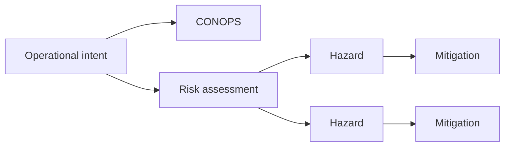

import ApiEndpoint from '@site/src/components/ApiEndpoint';
import EndpointTable from '@site/src/components/EndpointTable';
import {conopsResource, riskAssessments, riskHazards, riskMitigations} from '@site/src/data/operations-intents';

# CONOPS and Risk

The CONOPS (concept of operations) describes how an operation is run. The risk
assessment describes why it is safe: hazards, each with mitigations. Validation
checks that both are present and complete before approval.

All CONOPS text fields are required and non-empty. These records can be reused
by several intents; deletes fail while an intent or child record references
them.

<EndpointTable endpoints={[conopsResource.list, conopsResource.get, conopsResource.create, conopsResource.replace, conopsResource.remove, riskAssessments.list, riskAssessments.get, riskAssessments.create, riskAssessments.replace, riskAssessments.remove, riskHazards.list, riskHazards.get, riskHazards.create, riskHazards.replace, riskHazards.remove, riskMitigations.list, riskMitigations.get, riskMitigations.create, riskMitigations.replace, riskMitigations.remove]} />

## CONOPS

### List CONOPS \{#list-conops\}

<ApiEndpoint {...conopsResource.list} />

### Get a CONOPS \{#get-conops\}

<ApiEndpoint {...conopsResource.get} />

### Create a CONOPS \{#create-conops\}

<ApiEndpoint {...conopsResource.create} />

### Replace a CONOPS \{#replace-conops\}

<ApiEndpoint {...conopsResource.replace} />

### Delete a CONOPS \{#delete-conops\}

<ApiEndpoint {...conopsResource.remove} />

## Risk assessments

### List risk assessments \{#list-risk-assessment\}

<ApiEndpoint {...riskAssessments.list} />

### Get a risk assessment \{#get-risk-assessment\}

<ApiEndpoint {...riskAssessments.get} />

### Create a risk assessment \{#create-risk-assessment\}

<ApiEndpoint {...riskAssessments.create} />

### Replace a risk assessment \{#replace-risk-assessment\}

<ApiEndpoint {...riskAssessments.replace} />

### Delete a risk assessment \{#delete-risk-assessment\}

<ApiEndpoint {...riskAssessments.remove} />

## Risk hazards

### List risk hazards \{#list-risk-hazard\}

<ApiEndpoint {...riskHazards.list} />

### Get a risk hazard \{#get-risk-hazard\}

<ApiEndpoint {...riskHazards.get} />

### Create a risk hazard \{#create-risk-hazard\}

<ApiEndpoint {...riskHazards.create} />

### Replace a risk hazard \{#replace-risk-hazard\}

<ApiEndpoint {...riskHazards.replace} />

### Delete a risk hazard \{#delete-risk-hazard\}

<ApiEndpoint {...riskHazards.remove} />

## Risk mitigations

### List risk mitigations \{#list-risk-mitigation\}

<ApiEndpoint {...riskMitigations.list} />

### Get a risk mitigation \{#get-risk-mitigation\}

<ApiEndpoint {...riskMitigations.get} />

### Create a risk mitigation \{#create-risk-mitigation\}

<ApiEndpoint {...riskMitigations.create} />

### Replace a risk mitigation \{#replace-risk-mitigation\}

<ApiEndpoint {...riskMitigations.replace} />

### Delete a risk mitigation \{#delete-risk-mitigation\}

<ApiEndpoint {...riskMitigations.remove} />
