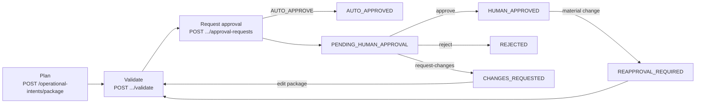

import ApiEndpoint from '@site/src/components/ApiEndpoint';
import ApiEnvironment from '@site/src/components/ApiEnvironment';
import EndpointTable from '@site/src/components/EndpointTable';
import {allEndpoints, health, pages} from '@site/src/data/operations-intents';

# Operations Intents API

Operations Intents is where operators plan flights and reviewers approve them.
An **operational intent** ties together where and when the flight happens
(4D volumes over 3D footprints), how it is run (a **CONOPS**), and why it is
safe (a **risk assessment** with hazards and mitigations). The intent is then
**validated** against airspace constraints and other traffic, and
**approved**, **rejected**, or sent back for **changes**.

The service is Fastify 5 with TypeScript, PostgreSQL with PostGIS through
Drizzle ORM, and the `uss_operations_api` schema. Validation calls the
[Constraint Management API](../constraint-management/overview) at
`CONSTRAINTS_API_URL`.

## Environment

<ApiEnvironment api="operations-intents" endpoints={allEndpoints} />

The service sends `Access-Control-Allow-Origin: *`, so the **Try it** console
works directly from the browser.

## Endpoint families

| Family | Base routes | Purpose |
| --- | --- | --- |
| [Operational intents](./endpoints/operational-intents) | `/operational-intents`, `/operational-intents/package`, `/intent-volumes-4d` | Intents, one-request packages, and volume links. |
| [Review workflow](./endpoints/review-workflow) | `/operational-intents/:id/validate`, `.../approval-requests`, `.../approve`, `.../reject`, `.../request-changes`, `.../review-status` | Validation and approval decisions. |
| [Volumes](./endpoints/volumes) | `/volumes-3d`, `/volumes-4d` | Footprints and time windows. |
| [CONOPS and risk](./endpoints/conops-and-risk) | `/conops`, `/risk-assessments`, `/risk-hazards`, `/risk-mitigations` | Operation concept and safety case. |
| [Audit log](./endpoints/audit-log) | `/audit-log` | Write and decision history. |

## Health

### Check service health \{#get-health\}

<ApiEndpoint {...health.get} />

## All endpoints

<EndpointTable endpoints={allEndpoints} pages={pages} />

## Recommended reading order

1. [Auth and Permissions](./auth-and-permissions)
2. [API Conventions](./api-conventions)
3. [Operational Intents](./endpoints/operational-intents), starting with the package endpoints
4. [Review Workflow](./endpoints/review-workflow)
