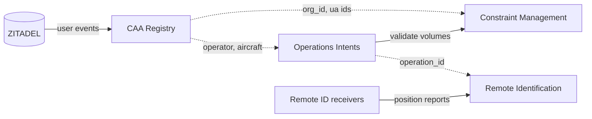

# API Reference

Each backend module owns its own API, auth rules, and data. Start from the
module you need; the [workflow below](#how-the-services-fit-together) shows how
they connect.

| API | What it owns | Auth | Entry point |
| --- | --- | --- | --- |
| CAA Registry | Organizations, users, operators, UA aircraft, Remote ID records, custom properties, audit. | ZITADEL bearer token, group-based permissions. | [CAA Registry API](./caa-registry/overview) |
| Constraint Management | Airspace constraints, 3D and 4D volumes, rules, volume properties, constraint snapshot. | Bearer token or trusted actor headers; `admin` and `auditor` roles. | [Constraint Management API](./constraint-management/overview) |
| Operations Intents | Operational intents, CONOPS, risk assessments, validation, and approval. | Bearer token or trusted actor headers; `operator` and `auditor` roles. | [Operations Intents API](./operations-intents/overview) |
| Remote Identification | Remote ID certificates, flight sessions, and received position reports. | Not enforced in the current build. | [Remote Identification API](./remote-identification/overview) |
| RID Auth Server | Drone credential provisioning and Remote ID verification. | Varies by endpoint. | [RID Auth Server API](./rid-auth-server/overview) |

## How the services fit together

1. **CAA Registry** registers who and what may fly. ZITADEL keeps its users in
   sync.
2. **Constraint Management** defines where and when flying is allowed.
3. **Operations Intents** holds planned flights and checks them against
   Constraint Management before a reviewer approves them.
4. **Remote Identification** records what aircraft broadcast during the
   flight.

The dotted links are ids copied between services. They are not checked across
service boundaries.

## Every API page has

- **Endpoint cards** with path, permission, auth, parameter tables, and body
  fields.
- **Generated request examples** in cURL, JavaScript, Python, and raw HTTP,
  built from your configured base URL.
- **Response examples** for every success status, plus an **Errors** tab
  listing each `detail` code and when it happens.
- A **Try it** console that sends real requests with a per-API environment
  (base URL and token), shows status, timing, size, and the response, and
  gives you the exact request as cURL.
- A **Postman collection** download on each API overview, generated from the
  same data.
