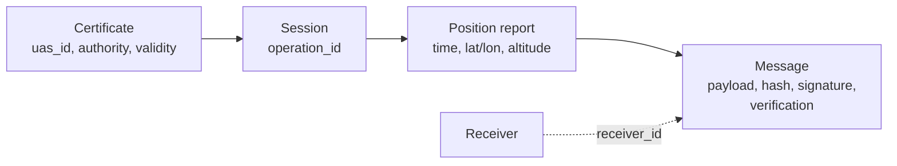

import ApiEndpoint from '@site/src/components/ApiEndpoint';
import ApiEnvironment from '@site/src/components/ApiEnvironment';
import EndpointTable from '@site/src/components/EndpointTable';
import {allEndpoints, health, pages} from '@site/src/data/remote-identification';

# Remote Identification API

Remote Identification stores what drones broadcast in flight. Receivers on the
ground capture Remote ID messages (Bluetooth or Wi-Fi broadcast, or network
Remote ID) and post them here as **position reports**. Reports belong to a
flight **session**, which ties the aircraft's **certificate** to an
operational intent.

The service is Fastify 5 with TypeScript and PostgreSQL through Drizzle ORM,
in the `remote_identification_api` schema. Every write is recorded in the
audit log.

## Environment

<ApiEnvironment api="remote-identification" endpoints={allEndpoints} />

:::warning[Authentication is not enabled]

This build does not register the auth plugin, so no route checks credentials
and audit entries record the actor as `system`. Restrict access at the network
or gateway layer until authentication is turned on. The examples omit the
`Authorization` header for the same reason.

:::

The service sends `Access-Control-Allow-Origin: *`, so the **Try it** console
works directly from the browser.

## Endpoint families

| Family | Base routes | Purpose |
| --- | --- | --- |
| [Certificates](./endpoints/certificates) | `/certificates` | Remote ID certificates per aircraft. |
| [Sessions](./endpoints/sessions) | `/sessions`, `/sessions/filter`, `/sessions/filter/single` | One flight under one certificate. |
| [Position reports](./endpoints/position-reports) | `/position-reports`, `/position-reports/filter`, `/audit-logs` | Received messages, positions, and audit history. |

## Health

### Check service health \{#get-health\}

<ApiEndpoint {...health.get} />

## All endpoints

<EndpointTable endpoints={allEndpoints} pages={pages} />

## Conventions

- Routes are at the service root. The local default is `http://localhost:8001`.
- Lists use `limit` (default `50`, max `200`) and `offset`, and return
  `{ items, limit, offset, has_more }`.
- Coordinates, altitudes, and speeds are `numeric`: send numbers, read strings
  such as `"25.085100"`.
- Errors are `{ "detail": "<code>" }`: `<field>_invalid` (400),
  `<entity>_not_found` (404), and `<entity>_has_invalid_reference` or
  `<entity>_has_linked_records` (409).
- `certificate.uas_id` and `session.operation_id` are plain UUIDs. The service
  does not check them against the CAA Registry or Operations Intents.
